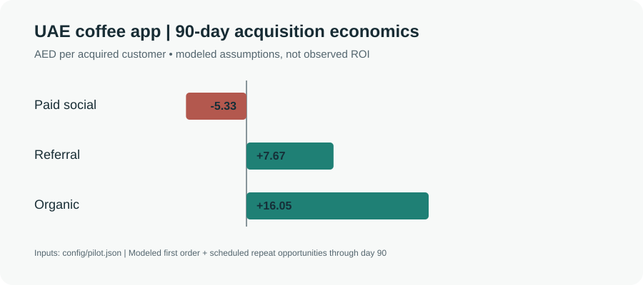

# UAE coffee app growth: when does paid acquisition break even?

## Interactive research dashboard

A responsive, self-contained dashboard accompanies the reproducible Python/SQLite analysis.

- [Open the dashboard source](site/index.html) (download the HTML file and open it in a browser; no server is required)
- Source-labelled competitor observations and independently modeled acquisition scenarios
- Searchable coffee-menu audit, contribution comparisons, retention cohorts, price-sensitivity controls, and Arabic content review
- Keyboard-usable filters, CSV export, and mobile layout

**Evidence boundary:** Public market observations and fictional customer/economics scenarios are clearly distinguished. This work is independent and is not based on Luckin Coffee customer data.


A compact decision model for a delivery-first coffee app entering a UAE market. The question is narrow: **which acquisition channel can fund its own first-order incentive within 90 days?** The model connects first-order discounts, repeat buying and acquisition cost, then checks the same logic against a generated order-event dataset using SQL.

This is a **scenario analysis**, not a report of Luckin Coffee transactions. The costs, margins, sample customers and retention assumptions are intentionally editable. No brand sales, customer information or conversion figures are claimed.



## Decision from the base assumptions

| Channel | Assumed CAC | First-order offer | Expected repeat orders by day 90 | CAC ceiling at break-even | Contribution after CAC |
| --- | ---: | ---: | ---: | ---: | ---: |
| Paid social | AED 15.00 | AED 6.00 | 0.65 | AED 9.68 | **AED -5.33** |
| Referral | AED 7.00 | AED 5.00 | 1.07 | AED 14.67 | **AED +7.67** |
| Organic | AED 2.00 | AED 0.00 | 0.90 | AED 18.05 | **AED +16.05** |

At an assumed AED 9.50 contribution per order *before* a first-order offer, paid social would require **CAC at or below AED 9.68**, or materially stronger repeat purchasing, to cover its 90-day economics. Referral can bear a higher acquisition cost under these assumptions. These numbers are model outputs, not observed channel performance.

## Why UAE / Dubai?

Official public context sets the operating geography, but does **not** provide coffee-app conversion rates:

- Dubai recorded **18.72 million** international overnight visitors in 2024 and **19.59 million** in 2025 ([Dubai Department of Economy and Tourism, 2024](https://www.dubaidet.gov.ae/en/research-and-insights/annual-visitor-report-2024); [2025](https://www.dubaidet.gov.ae/en/research-and-insights/tourism-performance-report-december-2025)).
- Dubai's resident population was **4.58 million at year-end 2025** ([Digital Dubai, July 2026](https://www.digitaldubai.ae/newsroom/news/dubai-digital-dubai%27s-population-tops-4.580-million-by-the-end-of-2025-recording-7.5-growth)).

Resident counts and visitor flows are different metrics; adding them together as a coffee-buying market would be wrong. The work therefore avoids producing a made-up TAM from these figures.

## What is implemented

- `src/growth.py`: deterministic order-event generator (1,300 fictional customers), unit economics and batch report generation. Four scheduled repurchase opportunities fall within day 90.
- `sql/cohort_report.sql`: customer-grain repeat-purchase rates at day 30 and day 90, acquisition cost and 90-day contribution by channel; avoids dividing by order counts instead of customers.
- `src/plot.py`: an SVG chart with modeled scenarios clearly labelled.
- `data/market_context.csv`: three directly sourced Dubai statistics, with source URLs.
- `tests/test_growth.py`: checks the break-even math, reproducibility, cohort denominators and order coverage.
- `docs/decision_note.md`: suggested holdout experiment and metric definitions.

## Reproduce

Requires Python 3.11 or newer; no API keys or paid services.

```bash
python -m unittest discover -s tests -v
python -m src.growth
python -m src.plot
```

Outputs are committed in `outputs/analysis.json` and `outputs/channel_economics.svg`. Change `config/pilot.json` to test an alternative retention curve or incentive, then regenerate the outputs. Seed: `20261119`.

## Accounting choices

For each acquired customer, there is one first order on day 0. Repeat orders may occur on days 14, 35, 62 and 87; each opportunity is modeled independently, using channel-specific assumptions.

```text
90-day contribution/customer = (1 + expected repeat orders) ×
    contribution per full-price order − first-order discount − CAC
```

The example contribution is after variable order economics but before shared overhead, tax, financing and new store investment. No claim is made that those costs equal a real UAE operator's cost base. Acquisition costs are assumed fully attributable to each newly acquired customer in the sample. There is no customer lifetime extrapolation beyond day 90.

## What I would validate before spending

1. Instrument `first_order`, `repeat_order`, `coupon_redeemed`, `refund`, `acquisition_source` and order-level contribution in a consent-aware event model; join them using stable pseudonymous IDs.
2. Randomize campaign exposure by eligible audience or geography, including a holdout; distinguish incremental acquisition from discount capture by customers who would have bought anyway.
3. Re-estimate retention and contribution separately for UAE resident vs visitor-heavy catchments, with enough sample to avoid a misleading citywide average.
4. Only scale a channel after actual 90-day contribution clears fully loaded CAC, with a confidence interval and a check for cannibalization.

**Scope:** Independent analytics exercise built from public city-level statistics and explicitly fictional transaction data. No affiliation with or access to internal data of Luckin Coffee or any other retailer.
